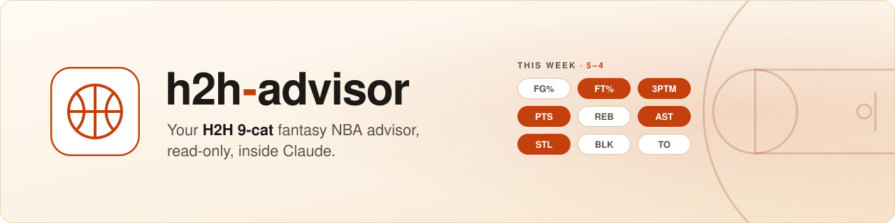
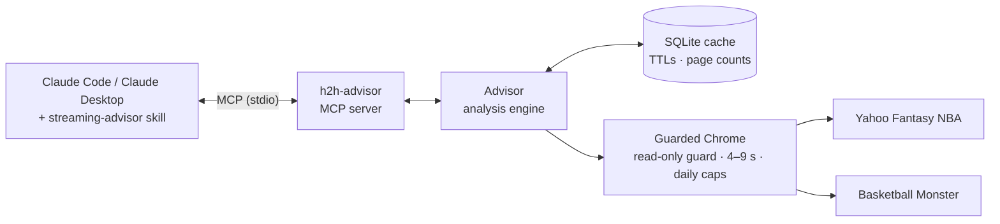

<p align="center">
  <picture>
    <source media="(prefers-color-scheme: dark)" srcset="docs/assets/readme/banner-dark.svg">
    
  </picture>
</p>

<p align="center">
  
  
  
  
  
</p>

<p align="center">
  Ask Claude how your Yahoo Fantasy NBA head-to-head leagues are going and who to stream.<br>
  h2h-advisor reads your matchups, rosters and free agents, adds Basketball Monster projections,<br>
  and lays out the options. <b>It never changes anything: every move stays yours.</b>
</p>

<p align="center">
  <a href="#quick-start"><b>Quick start</b></a> ·
  <a href="#install-in-claude-code">Claude Code</a> ·
  <a href="#install-in-claude-desktop">Claude Desktop</a> ·
  <a href="#what-you-can-ask">What you can ask</a> ·
  <a href="#how-it-works">How it works</a> ·
  <a href="#what-it-will-never-do">What it will never do</a>
</p>

## Quick start

For Claude Code, on a Mac with Google Chrome and [uv](https://docs.astral.sh/uv/):

**1.** Put the repository somewhere permanent, for example `~/Code/h2h-advisor`.

**2.** Install the plugin from that folder:

```sh
claude plugin marketplace add ~/Code/h2h-advisor
claude plugin install h2h-advisor@h2h-advisor
```

**3.** In Claude Code, run `/h2h-advisor:setup`. It walks you through logging in to Yahoo and
Basketball Monster, finds your leagues and writes your config, asking before each step.

**4.** Ask: *"how am I doing in all my leagues?"*

Using Claude Desktop instead? See [Install in Claude Desktop](#install-in-claude-desktop).

## Prerequisites

- **macOS.** Login and the browser use the Mac build of Google Chrome.
- **Google Chrome** in `/Applications`. If it lives elsewhere, set `H2H_ADVISOR_CHROME` to its
  binary. h2h-advisor drives your installed Chrome, so there is no Playwright browser to download.
- **[uv](https://docs.astral.sh/uv/).** It installs Python 3.12 and the dependencies the first
  time the server or a command runs.
- **A Yahoo Fantasy NBA account** with one or more head-to-head category leagues.
- **A Basketball Monster membership.** The daily projections need one.

## Install in Claude Code

**1. Get the code.** Clone or copy the repository to a permanent folder (`git clone <url>` once
it is published). A plugin installed from a local folder is read from that folder, so do not move
or delete it afterwards.

**2. Add the marketplace and install the plugin.** The repository is its own single-plugin
marketplace:

```sh
claude plugin marketplace add /absolute/path/to/h2h-advisor
claude plugin install h2h-advisor@h2h-advisor
```

On Claude Code 2.1.275 or later you can do both in one step:

```sh
claude plugin install h2h-advisor --marketplace /absolute/path/to/h2h-advisor
```

Once the repository is published on GitHub, use its `owner/repo` in place of the path.

**3. Set it up.** Start Claude Code and run:

```text
/h2h-advisor:setup
```

The setup skill checks uv and Chrome, opens the login window (only after you agree), lists your
leagues, asks about never-drop players, builds and stream slots, and shows you the whole config
file before it writes anything. Run it again any time to change something.

**Check it works:** ask *"how am I doing in all my leagues?"*. You should get a status table for
each league, with how old the Yahoo and Basketball Monster data is.

## Install in Claude Desktop

Claude Desktop needs two pieces: the MCP server, added by hand in its config file, and the
plugin, uploaded for the two skills. A plugin's local server does not run in Desktop chat, which
is why the server goes in the config file.

**1. Get the code** to a permanent folder, as for Claude Code, and find the absolute path of uv
(Desktop does not see your shell's `PATH`):

```sh
which uv
```

**2. Add the MCP server.** In Claude Desktop open **Settings → Developer → Edit Config**. This
opens `~/Library/Application Support/Claude/claude_desktop_config.json`. Add `h2h-advisor` under
`mcpServers`, with absolute paths for both uv and the repository:

```json
{
  "mcpServers": {
    "h2h-advisor": {
      "command": "/opt/homebrew/bin/uv",
      "args": ["run", "--directory", "/absolute/path/to/h2h-advisor", "h2h-advisor", "serve"]
    }
  }
}
```

Use the path `which uv` printed. If the file already has other servers, add the `h2h-advisor`
entry next to them. Then quit Claude Desktop completely (Cmd+Q) and open it again.

**3. Add the skills.** Open **Customize → Plugins → Add → Upload plugin** and pick the
repository folder, or a zip of it:

```sh
git -C /absolute/path/to/h2h-advisor archive --format=zip -o ~/Desktop/h2h-advisor.zip HEAD
```

This loads `streaming-advisor` and `setup` into chat. The uploaded plugin carries its own
server definition too, which may start a second h2h-advisor server. The one from step 2 is the one
chat uses; a second instance only serves cached data ("browser busy in another session"), which is
harmless. If you see the h2h-advisor tools twice, upload a copy of the folder without `.mcp.json`.

**4. Log in, in a terminal.** Desktop chat cannot open the login window for you:

```sh
uv run --directory /absolute/path/to/h2h-advisor h2h-advisor login
```

See [Logging in](#logging-in). Then write your config: edit it by hand (see
[Configuration](#configuration)) or run `/h2h-advisor:setup` once in Claude Code.

**Check it works:** in a new chat, ask *"how am I doing in all my leagues?"*.

> [!NOTE]
> A brief across all leagues loads several pages per league at a polite pace, so with fresh
> data to fetch it can take a few minutes. If Claude Desktop gives up on the tool call before it
> finishes, ask about one league at a time (*"how am I doing in &lt;league&gt;?"*); the pages
> already loaded are cached, so the next answer is faster.

## Logging in

```sh
uv run --directory /absolute/path/to/h2h-advisor h2h-advisor login
```

This opens an ordinary Google Chrome window on h2h-advisor's own profile, separate from your
everyday Chrome, with Yahoo Fantasy and Basketball Monster. Log in to both by hand. Then quit
that Chrome with **Cmd+Q**, or press **Enter** in the terminal. Closing the window is not
enough, because Chrome keeps running on macOS.

Why a plain window: Google refuses sign-in in browsers that automation controls ("This browser
or app may not be secure"). So login happens in a normal Chrome with no automation attached, and
h2h-advisor later reuses the cookies it saved. It never disguises automation.

Run `login` again whenever Claude says a site **needs login**.

## Why h2h-advisor

<table>
  <tr>
    <td width="33%" valign="top"><b>🛡️ Read-only by construction</b><br><sub>A request guard blocks every add, drop, trade, claim, lineup and settings request before it leaves the browser. No tool can navigate, click or type.</sub></td>
    <td width="33%" valign="top"><b>🐢 Polite to the sites</b><br><sub>One page at a time, 4–9 s between loads, daily caps of 250 Yahoo and 80 Basketball Monster page loads.</sub></td>
    <td width="33%" valign="top"><b>🗄️ Cached</b><br><sub>Matchups and rosters for 20 min, free agents 60 min, daily projections 3 h, rest-of-season 12 h, settings 7 days. A repeat question opens no browser.</sub></td>
  </tr>
  <tr>
    <td valign="top"><b>🏀 All leagues in one prompt</b><br><sub>One call covers the week outlook, top streamers, upgrades and waiver claims for every league.</sub></td>
    <td valign="top"><b>📅 This week vs Long-term</b><br><sub>Streaming options for the days left are kept apart from rest-of-season upgrades.</sub></td>
    <td valign="top"><b>🎯 Plays your format</b><br><sub>Ranks moves by expected categories won, or by the chance of winning the matchup in One Win leagues. Respects your build and never-drop list.</sub></td>
  </tr>
  <tr>
    <td valign="top"><b>⏳ Waivers labelled</b><br><sub>A waiver player is never shown as an immediate add: "on waivers, clears &lt;date&gt;", a claim or bid in FAB leagues, next to the best free agent you can add now.</sub></td>
    <td valign="top"><b>🕒 Honest about data age</b><br><sub>Every answer says how old the Yahoo and Basketball Monster numbers are and flags stale ones.</sub></td>
    <td valign="top"><b>🏠 Local</b><br><sub>Runs on your Mac. Your cookies, cache and config stay there.</sub></td>
  </tr>
</table>

## What you can ask

- *"How am I doing in all my leagues?"*
- *"Analyze my week in my main league."* (name a league by its name, part of its name, or its id)
- *"Best streamer today in my main league?"*
- *"Who should I stream for the rest of the week in my big-man league?"*
- *"Any long-term upgrades on the wire in my main league?"*
- *"Which categories should I chase and which should I punt this week?"*
- *"Is anything blocked or stale?"*

Claude answers with options, not verdicts: the add, the drop, which days the pickup plays, the
categories it moves and the adds you would have left. You make the move in Yahoo yourself.

## Tools

The MCP server exposes 16 tools. Thirteen are read-only; the three note tools write only a
local notes file (your short-lived guidance, see Configuration). None changes anything on Yahoo.

| Tool | What it returns |
|---|---|
| `list_leagues` | Your Yahoo NBA fantasy leagues (id and name) |
| `get_league_settings` | Scoring categories, roster slots, max adds per week and the current week |
| `get_matchup` | Both teams' category totals so far, for this week or a given week |
| `get_roster` | A roster with slots and injury status: yours, your opponent's or any team's |
| `get_free_agents` | Best available free agents and waiver claims, optionally for one position |
| `get_projections` | Basketball Monster projections for one day or the rest of the season |
| `get_schedule` | Which NBA teams play on each day between two dates (at most 14 days), from Basketball Monster's daily pages |
| `analyze_week` | Projected category outcome for the rest of the week, with swing categories |
| `rank_streamers` | Ranked add/drop streaming moves for today or the rest of the week |
| `plan_adds` | Dated add/drop plan for the rest of the week: the day to make each move; moves dated today are "do now" |
| `long_term_upgrades` | Free agents whose rest-of-season value beats someone on your roster |
| `get_history` | Results of this season's earlier matchup weeks |
| `daily_brief` | Status or moves for one or all leagues in one call |
| `status` | Login state, page loads against the daily caps, cache ages, blocked requests |
| `add_note` | Remember guidance on a player until a date: `keep` (never a drop) or `drop_first` |
| `list_notes` | The notes that still count today |
| `remove_note` | Forget one note |

## How it works



Claude calls a tool. The advisor answers from the cache when it is fresh. Otherwise it loads
the pages it needs in a headless Chrome on h2h-advisor's own profile, where every request goes
through the read-only guard. The game schedule comes from the games table of Basketball
Monster's daily pages, which it loads for every day of the week anyway. Then it projects the
rest of the week from Basketball Monster projections and the games each player has left, and
ranks the moves. Only one Claude session drives the browser at a time.
Other sessions answer from the cache.

One more source, outside the browser: ESPN's public game logs, for one signal only. Basketball
Monster's projections lag a role change, so a player it rates as a throwaway can be playing
25 minutes a night. For the few weakest players that could be offered as a drop, the advisor
reads their last five games' minutes (plain GET to `site.web.api.espn.com`, no login, nothing
about you, cached 6 h per player) and keeps anyone playing at least `rotation_gain_mpg` above
Basketball Monster's projected minutes off the drop list. The endpoint is unofficial: if it fails,
the check is skipped with a notice and everything else works.

<details>
<summary><b>Configuration</b></summary>

The config lives at `~/.config/h2h-advisor/config.toml`. If `H2H_ADVISOR_HOME` is set, everything
moves under it: the config to `$H2H_ADVISOR_HOME/.config/h2h-advisor/config.toml`, and the Chrome
profile and cache to `$H2H_ADVISOR_HOME/.local/share/h2h-advisor/`. Without a config file the
defaults apply. `/h2h-advisor:setup` writes the file for you. To edit it by hand:

```toml
[global]
never_drop = ["Victor Wembanyama"]   # never suggested as a drop, in any league
drop_margin = 0.25                   # drop pool: rostered players whose ROS value is at most the best free agent's + this
rotation_mpg = 20.0                  # recent minutes a night below which nobody is kept off the drop list
rotation_gain_mpg = 3.0              # kept off it when recent minutes beat Basketball Monster's projection by this

[league."12345"]                     # the league id from list_leagues, quoted
never_drop = ["Tyrese Haliburton"]   # added to the global list for this league
stream_slots = 5                     # drop pool = your bottom 5 by rest-of-season value
max_adds = 7                         # used only if the settings page shows no max adds
bbm_league_id = "1234"               # Basketball Monster league, when the name match fails
build = { strong = ["FT_PCT", "TPM", "PTS", "AST", "STL"], punt = ["FG_PCT", "TO", "BLK"], weak = ["REB"] }

[league."67890"]
never_drop = []                      # no build: inferred from your roster and history
```

Category names: `FG_PCT`, `FT_PCT`, `TPM`, `PTS`, `REB`, `AST`, `STL`, `BLK`, `TO`. Everything
in a league table is optional, and an unknown key there (a typo, say) makes loading fail with an
error. The server reads the config when it starts: after a change,
reconnect it (`/mcp` in Claude Code) or restart Claude Desktop.

`never_drop` is for players protected all season. Guidance that goes stale ("keep the backup big
while the starter is out", "the bench wing is useless, drop him first") is a **note**: tell Claude in conversation and it
stores one with `add_note`. A `keep` note takes the player off the drop list; a `drop_first` note
offers him first, even above replacement level, and counts none of his remaining games this
week. Each note has a last day (two weeks by default,
the week's end for "this week") and stops counting after it. Notes live in
`~/.local/share/h2h-advisor/notes.json`, are read on every call (no reconnect needed), and the
brief lists the active ones. `list_notes` and `remove_note` show and forget them.

Drop candidates are ranked by rest-of-season value **for the league's build**: the mean of
Basketball Monster's category values over the categories not punted. A shot-blocker who scores
little is not a throwaway on a punt-points team.

</details>

<details>
<summary><b>Troubleshooting</b></summary>

| Claude says | What it means and what to do |
|---|---|
| **yahoo needs login** / **bbm needs login** | The session expired, or the site asked for a captcha or a check. Run `/h2h-advisor:setup`, or `uv run --directory /absolute/path/to/h2h-advisor h2h-advisor login` in a terminal. |
| **browser busy in another session** | Another Claude session (Code or Desktop) is using the browser. You get cached data. Ask again when that session is idle. |
| **&lt;site&gt; answered 403/429/5xx: backing off** / **&lt;site&gt; backed off until** | The site refused or failed a page load. h2h-advisor stops loading from it for 15 minutes and shows cached data meanwhile; `status` shows `backed_off_until`. Ask again later. |
| A brief takes minutes, other questions wait | A brief holds the advisor (and its one browser) while it loads every league's pages, and other tool calls wait until it ends. `status` still answers. If it is too slow, ask about one league at a time. |
| **daily page-load cap reached** | The day's 250 Yahoo or 80 Basketball Monster page loads are used up. You get cached data until the next day. |
| **set bbm_league_id for &lt;league&gt;** | The league's name did not match a Basketball Monster league, so free agents came from Yahoo only. The notice lists each Basketball Monster league as `<value> = <name>`. Run `/h2h-advisor:setup` to pick it, or set `bbm_league_id` to that value in the config. |
| **could not read the &lt;page&gt; page** | The site changed its layout and the parser no longer reads it. That piece of data is missing until the parser is updated. |
| **That Chrome profile is already open** (from `login`) | The h2h-advisor Chrome is still running. Quit it with Cmd+Q and run `login` again. |
| The tools do not show up | In Claude Code, run `/mcp` to see the server's error. In Claude Desktop, check that both paths in `claude_desktop_config.json` are absolute, then quit and reopen the app. |

</details>

## What it will never do

> [!IMPORTANT]
> h2h-advisor only reads. It will never:
>
> - add, drop, trade or claim players, change lineups or settings, or send messages on Yahoo;
> - change anything on Basketball Monster except the three view controls on the projections
>   pages: the date, the player filter and the league view. Basketball Monster remembers the
>   league view, player filter and date last used, so its site may open on the ones h2h-advisor
>   used last;
> - hide that it is automated or try to get around bot detection: on a login page or captcha it
>   stops and asks you to log in;
> - send your data anywhere else. It talks only to Yahoo Fantasy and Basketball Monster.

## Development

```sh
uv sync
uv run pytest tests/test_service.py -v    # the test files for the code you change
uv run ruff check src tests
```

No test touches a live Yahoo or Basketball Monster site.

Working on it with a coding agent? Start with [`AGENTS.md`](AGENTS.md). Claude Code also loads
`CLAUDE.md` and `.claude/`: `/release`, `/fixture`, a `guard-reviewer` subagent and a ruff hook.
